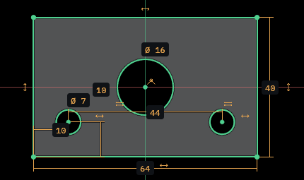

# Sketcher

The Sketch workbench draws flat outlines on a plane, holds them with
constraints and dimensions, and hands their closed areas to the features
that build solids.

Creating a sketch, choosing its plane and closing it again are described
in [Editing](EDITING.md#sketches). This guide covers what happens while a
sketch is open. Every number here can be a formula
([Variables and formulas](VARIABLES.md)), and every tool has a `sketch.*`
command behind it ([Scripting](SCRIPTING.md)).

## Drawing

Pick a tool from the toolbar's geometry row (the Geometry panel with
**Tool panels** on in Preferences › General › Interface) or by its key,
then click in the view. A panel's caption opens its full tool menu; use the
checkboxes to pin tools, or right-click a pinned button to unpin it.
**Reset pins** restores the workbench's defaults. A card by the
cursor names the tool, says what the next click does and lists the keys
that apply. Escape drops a typed value first,
then a half-drawn shape, then the selection.

| Tool | Key | Variants |
| --- | --- | --- |
| Point | O | |
| Line | L | |
| Polyline | P | |
| Arc | A | Center and endpoints, Three points |
| Circle | C | Center and rim, Three points |
| Ellipse | E | Center and axes, Three points, Arc of ellipse, Arc of parabola, Arc of hyperbola |
| B-spline | B | Open, Periodic, Through points, Closed through points |
| Rectangle | R | Two corners, Center and corner, Rounded, Three corners, Center and two corners, Frame |
| Regular polygon | G | Triangle to octagon (the Tool section sets any count from 3 to 12) |
| Slot | S | Straight slot, Arc slot |
| Text | | |

A tool's variants open from the dropdown beside its button. The task
panel's **Tool** section holds the options of the tool in hand: a
polygon's sides, a slot's width, a rounded rectangle's radius, a frame's
wall, a B-spline's degree, whether it is closed and whether its clicks are
points it passes through.

**Lines.** The line tool chains: each click ends one segment and starts
the next, and a right click, Enter or Escape finishes. Press on the end
the tool is drawing from and drag: that segment is an arc tangent to the
one before, and the tool goes on with lines from the arc's end. A first
press dragged and let go draws one line to where it was let go.

**Polyline.** The polyline draws lines and arcs in one run. M switches
the next segment in turn between a line, a tangent arc, a square arc and a
reversed arc; each arc stays tangent to what comes before it. A click back
on the first point closes the shape and ends the run.

**Typed values.** While a shape is being drawn, the card by the cursor
shows its sizes as they follow the cursor: a line's length and angle, a
rectangle's width and height, a circle's diameter, an arc's radius and
sweep, a polygon's radius and turn, a slot's length, angle and width.
Before the first click it shows X and Y, so the first point can be typed
too. Start typing and the value goes into the first field; Tab moves to
the next. A field takes a number or a formula over the document's
variables (`Printer.wall * 2`), worked out once as it is entered; the
shape keeps no link to the formula. Escape empties the fields.

- **Enter** places the click at the typed values and adds dimensions that
  hold them.
- **A click** uses the typed values to place the point but keeps the shape
  free: no dimension is added.

Some steps only place a point (a three-point shape's first point, an
ellipse's axes); there the card says "Enter places it". A value that does
not work out is named in the log and left in the field to be mended.
Once a value is typed, moving the cursor back across the start does not
flip the shape over.

## Snaps, hints and auto constraints

The cursor is drawn to ends, midpoints, centres, curves, intersections
and the sketch's axes. While a line is drawn it also snaps level or plumb
with its start, parallel or square to a line it passes near, and onto a
line's extension past its end. A dashed hint line shows which snap is
taking the cursor, and the click leaves the matching constraint
(horizontal, vertical, parallel, perpendicular, point on object). A
direction that reaches a curve or an axis near the cursor lands where it
crosses it, and the click leaves both (the hint names both, "Perpendicular
to · On axis").

The toolbar's Snap to objects and Grid buttons, and the drawing switches
in the task panel's **Display & snapping** fold (Show grid, Grid auto
spacing, Snap to grid, Snap to objects, Auto constraints), turn these on
and off for the session.

**Joining by dragging.** Drag a point onto another point or onto a curve
and hold it there a moment: when you let go, it is joined with a
coincident or point-on-object constraint. How long it must rest is
Preferences › Sketch › Drag constraint delay (400 ms to start). It needs
Auto constraints on.

## Constraints and dimensions

Select elements, then pick a constraint. A plain letter picks a drawing
tool; Shift and a letter picks a constraint.

| Constraint | Key | Variants |
| --- | --- | --- |
| Coincident | Shift+C | |
| Point on object | Shift+O | Point on object, Midpoint |
| Horizontal | Shift+H | Horizontal, Horizontal or vertical (whichever is nearer) |
| Vertical | Shift+V | |
| Parallel | Shift+P | |
| Perpendicular | Shift+N | |
| Tangent | Shift+T | |
| Equal | Shift+E | |
| Symmetric | Shift+S | |
| Block | Shift+B | |
| Group | Shift+G | |
| Dimension | Shift+D | |
| Lock | Shift+K | |
| Horizontal distance | Shift+L | |
| Vertical distance | Shift+I | |
| Distance | | Distance, Gap between curves |
| Arc length | | |
| Radius | Shift+R | Radius, Radius or diameter by kind, An ellipse's minor radius |
| Diameter | | |
| Angle | Shift+A | Between two lines, To the X axis, To the Y axis, Where two curves meet, An arc's opening, By three points |
| Refraction | | |

**Dimension** (Shift+D) gives whatever the selection takes: a length, a
distance, a radius or an angle. **Lock** holds a point where it is, as two
distances from the origin. **Block** fixes an element in place.

**Symmetric** takes two points and a line, three points (the last is the
centre), or a curve and then a line: the curve's two ends mirror each
other about the line.

**Group** (Shift+G) holds the selected elements together as one rigid
piece. The piece keeps its shape but still moves and turns: drag any
member and the whole group comes with it.

**Waiting for picks.** A constraint or dimension tool picked while the
selection does not fit it yet stays armed (its button lit) and takes more
clicks. A click on the sketch adds an element; a click on an edge of a
solid adds that edge, or the vertex at its end. Once the picks fit, the
model's edges are projected into the sketch as guides and the constraint
goes on, all as one undo step. Enter applies the tool to a single item;
Escape or a right click puts it away. [Editing](EDITING.md#sketches) has
more on this.

**Editing a dimension.** A new dimension opens its editor by its label,
with the measured value selected: type a value or a formula and press
Enter, or press Escape to keep the measured value. Cancel takes the new
dimension away again. A double click on a
dimension's label opens it again. For a circle or arc, the editor's **Ø**
and **R** buttons switch between dimensioning the diameter and the
radius; for an arc's length, **L** and **°** switch between its length
and its sweep in degrees. The editor also offers the document's variables and "Save as
variable" ([Variables and formulas](VARIABLES.md#sketch-dimensions)).
Drag a label to move it.

**Renaming.** A double click on a geometric constraint's glyph opens its
row in the constraint list for a new name. A named dimension can be read
by formulas elsewhere.

**The task panel.** Its header names the sketch, says what it stands
on, and shows the solver's state as a pill (degrees of freedom left,
fully constrained, conflicting); **Cancel** puts the sketch back as the
session found it and **Done** keeps it. Under it, the **Elements** and
**Constraints** lists, each folding on its own, share one filter: type a
name, or choose Selected, Related to selection, Relations, Dimensions,
Reference, Named, Parked, Normal geometry or Construction. An element row
shows its size (a line's length, a radius, a point's place); a constraint
row names its kind and the elements it ties ("Length · Line 2"), its value
plain until the row is hovered or selected, when the field and its fx
show. Hovering a row lights what it stands for in the view. While a
filter narrows the constraints, **Delete N shown** deletes every one it
shows. A constraint row's menu activates or deactivates it, makes a
dimension driving or reference (measured, not enforced), renames, parks
or deletes it. **Placement**, **Solver** and **Display & snapping** fold
away at the end, each with a one-line summary; **Labels show**, in
Display, sets what a dimension's label reads: its value, its name, or
both.

The toolbar's constraint row also has Toggle driving / reference, Toggle
active, Park / unpark constraints (parked glyphs draw only while Show
parked constraints is on), Remove axis alignment, and selectors for
conflicting, redundant, malformed and under-constrained elements. The
badge in the view's corner gives the sketch's degrees of freedom, and the
header's pill what the solver found; a conflict or redundancy also shows
a card at the top of the panel, which selects what the offending
constraints hold when clicked. The **Solver** fold holds how the solver
runs (auto update, removing redundants, its step limit and tolerance).

## Modifying

| Tool | Key | What it does |
| --- | --- | --- |
| Fillet | | Rounds a corner, or joins two curves with an arc (variant: Chamfer) |
| Trim | T | Removes the span clicked, or every span a drag crosses |
| Extend | | Extends a curve's end to the next curve |
| Split | | Splits a curve where you click |
| Copy, Move, Rotate, Scale | | Copy, move, turn or size the selection from a base point or pivot |
| Offset | | Copies a curve or chain at a distance |
| Symmetry | | Mirrors the selection about a line, two points or a point |
| Rectangular array | | Copies the selection into rows and columns |
| Join curves | | Merges a chain of curves into one B-spline |

Fillet and Chamfer take a radius or length in the Tool section, and
**Keep it** leaves the corner as a construction point on both curves,
with its constraints.

**Trim and Extend at the axes.** By default the sketch's axes do not cut.
Press U while Trim or Extend is in hand, or tick **Cut at the axes (U)**
in the Tool section, and the two axes cut as curves do; an end left on an
axis is held on it.

**Patterns.** Move, Rotate and Scale take a number of copies. For Move and
Rotate:

- **Includes the original**: the count is every element, the original
  among them, and the clicks span the whole pattern.
- **Symmetric**: the copies repeat on both sides of the original.
- **Full turn** (Rotate): the copies go evenly round 360°; click only the
  centre.
- **Follow the original**: the copies stay the original's size, spaced by
  one pitch, as the original changes.

Offset can round its corners, go to both sides, replace the original, or
stay held to the original by one dimension. Symmetry can keep the original
and hold the image to it with symmetric constraints. Copies, patterns and
arrays keep text as text.

Manual dimension labels move, turn, mirror and scale with their geometry,
including labels on copies. Their text size stays set by Appearance.
Automatic labels are placed for the current view. A dimension spanning
selected and unselected elements keeps its placement.

## Selecting and viewing

- A click selects an element or a constraint glyph; Ctrl adds. A drag on
  empty space draws a selection box: dragged left to right it takes what
  lies wholly inside (drawn solid), right to left whatever it touches
  (drawn dashed).
- Where elements lie on one another, a click takes drawn geometry before
  construction, and a click again on the selected one takes the next one
  under it.
- Hovering a row of the panel's constraint or element list lights it in
  the view. Applying a constraint clears the selection for the next picks.
- A double click on a curve selects its whole chain, drawn and projected
  curves alike.
- A double click on a constraint's glyph renames it (a dimension's opens
  its editor).
- A double click on empty space turns the view square onto the sketch
  again. **View sketch** (V) does the same.
- Edit › Cut, Copy and Paste carry sketch geometry between sketches.
- **Construction** (N) turns the selected elements into construction
  geometry and back. With nothing selected it switches the sketch's
  construction mode, in which everything drawn is construction. Each
  sketch keeps its own mode.
- **Show/hide internal geometry** (I) adds or removes the construction
  lines and points that show a curve's frame: an ellipse's axes and foci,
  a parabola's or hyperbola's axis and focus, a B-spline's control
  polygon. Shown, they size and reshape the curve like any geometry.
- **Section view** cuts the view at the sketch's plane;
  Preferences › Sketch › Section view on open sets whether a sketch opens
  that way. Show/hide constraints, Rendering order (construction or
  normal geometry on top), Curvature comb and Show knots are on the same
  row.

## Regions and profiles

While a sketch is edited, what its profile closes is shaded: what a pad
takes, holes left open. A curve's loose end, which the profile leaves
out, has a red ring once no shape is being drawn.

Curves may cross, branch or leave a spur. Every closed area between them
is a region: two overlapping circles make three, the lens and two
crescents. Pad, Pocket, Revolution and Groove take every region by
default, and can take only the ones you click in the view or tick in
their task, so two crossing circles can pad just their overlap
([Editing](EDITING.md#design-features)).

Out of editing, a closed sketch shades every region on its own, so each
one can be seen and picked. The regions a plain Pad takes (every loop, a
loop inside another a hole) shade a little stronger than the rest, such as
a disc inside a ring. The region under the pointer lights in the hover
colour; click it to pick it alone, Ctrl+click to add or take away regions,
and picked regions draw in the selection colour. Pad, Pocket, Revolution
and Groove started then take exactly the picked regions. Ctrl+click on a
curve picks the curve itself. A click on the sketch's lines or its tree row
selects the whole sketch, and with the whole sketch a Pad takes what it
always took.

**Validate sketch** reports stray points, constraints naming missing
geometry and whether the sketch closes, and selects what it finds. **Check
wall thickness** marks where the profile gets thinner than Preferences ›
Sketch › Minimum wall.

## Repair

**Repair sketch** (the sketch row of the toolbar) puts right what stops an
outline from closing or solving: ends that nearly meet (within the snap
reach) become one point, curves of no length and doubled curves go, and
constraints left naming nothing, or the same thing twice, go with them.
An arc whose two ends meet becomes the circle it nearly was, keeping what
named it. Drawn ends stay drawn. The log says what it did. Imported outlines need it
most.

## Reference pictures

File › Import takes a PNG or JPEG as a reference picture. It lies on the
plane of the sketch being edited (else in a new sketch), shown while the
sketch is edited, to draw over. It only draws: no profile and no
constraint come of it. Seen at an angle, it draws in true perspective.

The task panel's **Reference images** section sets each picture's middle,
width, turn and opacity, and removes it.

**Calibrate** sizes a picture from a length you know on it: click the two
ends of that length on the picture, type the real length (a value or a
formula), and Apply. Two options go with it:

- **Straighten to 45°** turns the picture so the line lies along the
  nearest 45° direction.
- **Centre on the line** moves the picture so the line's middle is the
  sketch's origin.

File › Import also reads a DXF drawing into a new sketch.

### A picture's scale

A picture placed without a width takes the size its file states (a
PNG's or JPEG's resolution), and says so: until it is measured against
something of known size, an **UNCALIBRATED** mark stands on its corner
with where its scale came from. Calibrate it by a distance (the panel's
Calibrate: two points and the length between them) or by a circle:
`pc.sketch.calibrate_image{sketch = s, x = …, y = …, diameter = 10}`
fits the circle whose rim the point is on (a gauge pin or a washer laid
on the glass beside the part) and scales the picture about its centre.

A scanner's sensor and its carriage may not agree, a picture coming out
a little stretched one way. `pc.sketch.calibrate_axis{sketch = s, from =
{x, y}, to = {x, y}, length = 100, axis = "y"}` scales the picture along
one of its own axes only: calibrate across with a ruler laid along the
rows, then down with one laid along the columns. Every measure reads the
picture as stretched. `pc.sketch.save_scanner_profile{sketch = s, name =
"flatbed 600"}` keeps what a calibrated picture's pixels measure (in the
configuration folder's `scanner_profiles.json`), and a later picture
whose file states the same resolution takes that scale when it is placed
without a width, or `sketch.image{profile = …}` names one.

### Squaring a picture

`pc.sketch.align_image{sketch = s, origin = {x, y}, toward = {x, y}}`
moves and turns a picture so the first point is the sketch's origin and
the second lies along +x from it (a sheet's edge, a part's datum).
`pc.sketch.turn_image{sketch = s, quarters = 1}` turns it by quarter
turns about the origin, and `mirror = true` shows a part scanned face
down as it is.

### Edges of a picture

A picture of a part on a flatbed scanner is a measurement once it is
calibrated. Its edges are found as it loads, to a tenth of a pixel, and
drawn over it in the external colour while the sketch is open.
**Fit to a picture's edge** (External geometry row) fits a click: it
starts from a dozen edge points at the click and runs on both ways
while each next point keeps to the shape, so a line stops at a corner
and a circle runs round its whole rim. It takes the shape that runs
further, logs how far the points stray (σ), and refuses a line on a
curve or a circle on less than 8° of round.

While a picture's edges are found, a click of Point, Line, Polyline,
Arc or Circle by three points, or B-spline lands on the nearest edge
within the snap reach, anywhere along it to a fraction of a pixel, and a
loupe beside the cursor shows the picture round the point magnified four
times, its edges and the point crossed. A point, a curve's end or a
crossing within reach still wins. Hold Alt to place the click where it
is.
`pc.sketch.fit_edge{sketch = s, x = …, y = …, kind = "circle"}` does
the same from a script; with `box = {{x, y}, {x, y}}` it fits every edge
point in the box instead, leaving out the points that stray past three
times the median stray (a burr, a speck of dust, a neighbouring edge)
and answering how many went.

`pc.sketch.image_objects{sketch = s}` finds the separate parts on the
sketch's pictures: the picture is split into part and ground by its grey
level, and each part is measured in millimetres where the picture lies.
You get its area (holes left out), its holes, centroid, the diameter of
a disc of the same area, its widest and narrowest caliper widths and the
direction of its long axis; `outlines = true` adds its boundary. Lay a
handful of washers on the glass and read them all at once.

`pc.sketch.bolt_circle{sketch = s, circles = {…}}` puts the circle
through the centres of three or more circles (a flange's bolt holes) as
construction, with how far each hole strays from it and its angle round
it.

`pc.sketch.image_profile{sketch = s, x = …, y = …}` reads the part
nearest a point as its radius against angle round its centroid and
counts the profile's peaks that stand out by at least `prominence`
(0.2 mm): a gear's teeth or a knurl's ridges, with their pitch and the
profile's inner and outer radius.

## Text

The Text tool writes outlines on the sketch: click where the text starts.
The Tool section (and, with a text selected, its **Text** section) sets
the text, the font, its size, spacing and angle. The font is one of the
bundled IBM Plex faces, an installed font chosen by family, or a font
file. An installed font or a font file is kept in the document, so the
text rebuilds the same on another computer. Size, spacing and angle can
be set by a formula ([Variables and formulas](VARIABLES.md)); the letters
are made again at the new value.

## External geometry

**External geometry** (X) brings a solid's edges into the sketch,
projected onto its plane. Click edges, or a face for every edge around it;
Ctrl picks more. Its **Intersection with faces** variant takes faces
instead and adds the curves where they cross the sketch plane. **External
from a sketch or datum** brings in another sketch's curves or a datum's
line, point or crossing.

Projected geometry is drawn in the external colour. It is a guide
(dashed) until it counts in the profile (solid): **Construction** (N), or
**Toggle external geometry in profiles**, switches the selected
projections between the two. New projections follow the construction
mode: guides in it, counting out of it. Projected geometry is never
dragged.

Projected geometry follows its source: when the solid, sketch or datum
changes, the projection is brought up to it without the sketch being
opened, including edges of the sketch's own body, keeping the constraints
on it where the shapes are the same kind. When what it came from is gone,
the elements stay where they were, their rows in the task panel's
**Elements** list read "lost", and the sketch's row in the tree shows a
warning badge saying how many were lost. Edit the sketch to remove or
replace them.

## Sketching on a scan

Select an Inspection section or fitted plane and Create sketch puts the
new sketch on it, in a body of its own. While a sketch is open, every visible scan its plane crosses shows the
cut as a dashed line: the slice of the scan at the sketch plane, moving
with the plane and with the scan when it is aligned. Place the sketch on
a fitted plane, a coordinate plane or at an offset to choose the slice.

**Fit the scan's section** (External geometry row) turns every slice
into lines and arcs end to end, each scan point within 0.1 mm of its
piece, a closed slice closing so it pads at once. Sharp corners the scan
rounds off come back sharp, lines within 3° of the sketch's axes turn
onto them, and slices shorter than 1 mm are left out. In Construction
mode the pieces come in as construction, to draw over.
`pc.sketch.fit_scan{sketch = s, tolerance = 0.05, axis_snap = 0}`
changes those.

The slice draws in the fitting colour where it lies within the **Scan
fit range** (Preferences › Sketcher › Printing, 0.1 mm) of the sketch's
curves, and in the conflict colour where it strays, and the status bar
counts the points within range: draw or dimension, and see at once
where the sketch leaves the part.

Each fitted piece keeps the slice points along it. Constraints and
dimensions are always met exactly; the points then decide what they
leave free, by least squares. Dimension a fitted outline 20 × 30 and it
stays where the scan is, square to its sides, rather than wherever the
solver last left it. A dimension the rest cannot meet is reported as a
conflict, never bent to fit the points.

### Design values

Geometry fitted to a scan reads 19.98 where the part was drawn at 20.
Select lines, arcs or circles while the sketch is open and each shows
its size next to its probable design value (halves under 10 mm, whole
millimetres above, radii to 0.5 mm). **Dimension at design values**
holds the selected ones there with driving dimensions, or every unsized
one when nothing is selected.

`pc.sketch.candidates{sketch = s}` lists the same sizes, and the
relations the geometry nearly keeps but no constraint states yet
(horizontal, vertical, parallel, perpendicular, equal, concentric), each
with how far it is off: evidence to weigh, never applied on its own.
`pc.sketch.design_values{sketch = s, elements = {…}}` holds sizes.

## Saving as DXF, SVG or CSV

**Save as DXF…**, **Save as SVG…** and **Save as CSV…** (the sketch
tools) write the open sketch at true scale in its own millimetres.

The DXF is R2000 with its unit declared. Lines, circles and arcs are
written as themselves and other curves as polylines within 0.01 mm, on
layer ELEMENTS; construction and guides go dashed on CONSTRUCTION, the
pictures' edges, thinned to 0.01 mm, dashed on PICTURE_EDGES, and text
blocks as text on NOTES. NOTES also holds a traceability line under the
drawing: the scale, each picture's millimetres per pixel and where that
came from (as given, the file's dpi, or what it was calibrated by), and
the sketch's frame (its plane's origin and axes).
`pc.sketch.export_dxf{sketch = s, path = …, units = "inch"}` writes it
in inches; a DXF written comes back through File › Import.

The SVG is a millimetre a unit, y up as in the sketch, every curve a
polyline within 0.01 mm, guides dashed, the traceability line under it:
ready for a laser cutter or a plotter (`sketch.export_svg`).

The CSV starts with the traceability line (`#`), then a row per element
(kind, id, drawn or construction, its points, radius and length) and
per dimension (kind, id, name, driving or reference, value and unit);
`pc.sketch.export_csv{sketch = s}` answers it as text.

## Merge and carbon copy

**Merge sketches** makes a new sketch of this one and the sketches you
tick; the originals stay as they are. **Carbon copy** copies another
sketch's geometry into this one, with its constraints, as geometry of
this sketch. Both need sketches on a parallel plane. Under a turn or a
mirror between the planes, constraints stated against the sketch axes
follow, and projected geometry stays projected from its solid, sketch or
datum.

**Mirror sketch** makes a new sketch on the same plane with this one's
geometry mirrored across its Y axis. **Attach sketch** moves the sketch
onto the face selected on the solid, and **Reorient sketch** flips its
normal or turns it 90°.

## Preferences

Preferences › Sketch holds the workbench's settings.

**Solver & constraints:** Auto constraints, Drag constraint delay, Hint
lines (the dashed guides; off, the snaps still work), Avoid redundant auto
constraints, Auto remove redundants, Ask for a dimension's value, Snap to
objects, Section view on open, Shade closed regions.

**Printing:** Minimum wall, for the wall thickness check.

**Appearance:**

| Setting | What it sets |
| --- | --- |
| Label size | The size of the dimensions' values |
| Label face | Monospace or Sans |
| Dimension lines | How wide dimension, extension and leader lines draw |
| Dashed dimension lines | Tones the dimensions down against the geometry |
| Axes | How wide the sketch's axes draw while not picked |
| Dashed axes | |
| Grid | How much the grid shows, from faint to solid |
| Region shading | How strongly closed regions are shaded |

**Colors** shows the sketch palette.

## Keys

The tool keys and M can be changed in Preferences › Keyboard; U, Tab,
Enter and Escape are fixed.

| Keys | Tools |
| --- | --- |
| O, L, P, A, C | Point, line, polyline, arc, circle |
| E, B, R, G, S | Ellipse, B-spline, rectangle, polygon, slot |
| T, X, N | Trim, external geometry, construction |
| V | View sketch |
| I | Show or hide internal geometry |
| M | Polyline: switch between lines and arcs |
| U | Trim or Extend: cut at the axes |
| Shift+C, Shift+O | Coincident, point on object |
| Shift+H, Shift+V | Horizontal, vertical |
| Shift+P, Shift+N, Shift+T | Parallel, perpendicular, tangent |
| Shift+E, Shift+S | Equal, symmetric |
| Shift+B, Shift+G, Shift+K | Block, group, lock |
| Shift+D, Shift+R, Shift+A | Dimension, radius, angle |
| Shift+L, Shift+I | Horizontal, vertical distance |
| Tab, Enter | Next typed field; place and constrain |
| Escape | Drop a typed value, then a half-drawn shape, then the selection |

While a value is being typed, number keys go to it.
